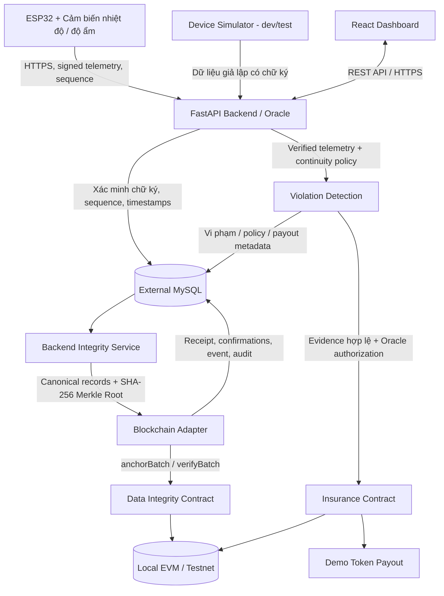

# Smart Cold Chain Insurance

**Giám sát chuỗi vận chuyển lạnh bằng IoT, xác minh tính toàn vẹn dữ liệu trên Blockchain và mô phỏng bảo hiểm tự động bằng Smart Contract.**

## 1. Tổng quan

`smart-coldchain-insurance` theo dõi nhiệt độ và độ ẩm trong quá trình vận chuyển hàng hóa yêu cầu bảo quản lạnh. ESP32 gửi telemetry có chữ ký số lên FastAPI. Backend xác minh nguồn gửi, phát hiện mẫu trùng hoặc thiếu, lưu dữ liệu trong MySQL và đóng các mẫu hợp lệ thành những batch có Merkle Root. Smart Contract lưu hash đại diện cho batch để hỗ trợ đối chiếu dữ liệu về sau.

Đồng thời, Backend đánh giá vi phạm nhiệt độ theo chính sách riêng của từng lô hàng. Khi có **bằng chứng đủ điều kiện**, Backend đóng vai trò **Oracle** gửi sự kiện đến Insurance Contract để thực hiện **chi trả token demo**. Giao diện web hiển thị dữ liệu, cảnh báo, trạng thái xác minh và các giao dịch Blockchain **thông qua REST API của Backend**.

### Mục tiêu chính

- Nhận và theo dõi dữ liệu nhiệt độ/độ ẩm từ ESP32 hoặc simulator.
- Xác minh chữ ký thiết bị, phát hiện replay/duplicate, sequence gap và thiết bị offline.
- Lưu **toàn bộ telemetry trong MySQL**, không ghi từng mẫu cảm biến lên Blockchain.
- Đóng batch, tính SHA-256 Merkle Root, anchor root trên Data Integrity Contract và phát hiện dữ liệu bị sửa đổi sau khi anchor.
- Phát hiện nhiệt độ vượt ngưỡng **liên tục ít nhất 15 phút** theo policy; không tự suy diễn vi phạm khi mất dữ liệu.
- Sử dụng Insurance Contract để kiểm soát policy, Oracle và chống chi trả trùng; mô phỏng payout bằng token local/testnet.
- Cung cấp Dashboard responsive; triển khai FastAPI public trên Render với MySQL bên ngoài Render.

## 2. Kiến trúc hệ thống



**Điểm phân biệt quan trọng:**

1. **Chữ ký số thiết bị:** xác minh payload được ký bằng khóa gắn với thiết bị đã đăng ký, không tự chứng minh cảm biến vật lý đo đúng.
2. **Merkle Root:** cam kết nội dung một batch; hash khớp không tự chứng minh dữ liệu không bị thiếu.
3. **Blockchain anchoring:** chứng minh một root được tài khoản được phép ghi nhận on-chain; không thay thế MySQL.
4. **Insurance Contract:** ghi nhận việc Oracle được ủy quyền yêu cầu xử lý policy và kết quả payout theo giao dịch thực tế, không thể tự đọc cảm biến hay REST API.

### Công nghệ dự kiến

| Thành phần | Công nghệ / trách nhiệm |
|---|---|
| Thiết bị | ESP32, Arduino/C++, cảm biến nhiệt độ và độ ẩm |
| Chữ ký telemetry | ECDSA P-256 + SHA-256; DER/Base64; khóa public đăng ký ở Backend |
| Backend | Python, FastAPI, REST API, OpenAPI |
| Database chính | **MySQL** (external managed MySQL cho production), migrations bằng Alembic nếu được áp dụng |
| Data Integrity | Canonical JSON, SHA-256, Merkle Tree, persistent batches/outbox |
| Blockchain | Solidity, Hardhat, TypeScript, local EVM/testnet |
| Smart Contracts | `ColdChainDataIntegrity.sol`, `ColdChainInsurance.sol`, `MockInsuranceToken.sol` (token tùy cấu hình demo) |
| Frontend | React, Vite, TypeScript; Leaflet cho bản đồ vị trí mô phỏng |
| Public Backend | Render Web Service, HTTPS, kết nối MySQL ngoài Render |

> Các lựa chọn trên là **thiết kế được đề xuất trong Roadmap**, không phải danh sách thư viện đã được cài đặt hoặc kiểm thử ở repository.

## 3. Nhóm và phân công

| Thành viên | Vai trò | Phạm vi sở hữu |
|---|---|---|
| **NTK — Member 1** | IoT, Backend & điều phối tích hợp | `device/`, `backend/`, `docs/contracts/api-v1.md`; chủ trì kiến trúc dữ liệu và triển khai Render |
| **NTD — Member 2** | Blockchain & Smart Contract | `blockchain/`, ABI, scripts deploy, test Hardhat, `blockchain/INTEGRATION.md` |
| **TTDK — Member 3** | Frontend & QA | `frontend/`, Dashboard, kết nối API, kiểm thử giao diện, demo |

Ba Roadmap chi tiết:

- [ROADMAP_NTK_IOT_BACKEND.md](ROADMAP_NTK_IOT_BACKEND.md)
- [ROADMAP_NTD_BLOCKCHAIN_SMART_CONTRACT.md](ROADMAP_NTD_BLOCKCHAIN_SMART_CONTRACT.md)
- [ROADMAP_TTDK_FRONTEND_QA.md](ROADMAP_TTDK_FRONTEND_QA.md)

**Nguyên tắc phối hợp:** NTK là owner hợp đồng API, NTD là owner giao diện Smart Contract, TTDK chỉ tiêu thụ REST API. Không tự thay schema, event, ABI hoặc tên trạng thái mà chưa cập nhật tài liệu hợp đồng và thông báo nhóm.

## 4. Cấu trúc repository mục tiêu

Cấu trúc dưới đây là **đích triển khai**, không phải cây thư mục đã được xác nhận có sẵn:

```text
smart-coldchain-insurance/
├── device/
│   ├── esp32/
│   │   ├── cold_chain_device.ino
│   │   ├── config.example.h
│   │   └── README.md
│   ├── simulator/
│   │   └── send_telemetry.py
│   └── README.md
├── backend/
│   ├── app/
│   │   ├── main.py
│   │   ├── api/
│   │   │   ├── devices.py
│   │   │   ├── telemetry.py
│   │   │   ├── integrity.py
│   │   │   ├── shipments.py
│   │   │   ├── insurance.py
│   │   │   └── health.py
│   │   ├── services/
│   │   │   ├── telemetry_service.py
│   │   │   ├── signature_verification_service.py
│   │   │   ├── integrity_service.py
│   │   │   ├── batch_service.py
│   │   │   ├── violation_service.py
│   │   │   └── route_simulator.py
│   │   ├── integrations/
│   │   │   └── blockchain_adapter.py
│   │   ├── models/
│   │   ├── schemas/
│   │   └── core/
│   ├── alembic/
│   ├── tests/
│   ├── requirements.txt
│   └── .env.example
├── blockchain/
│   ├── contracts/
│   │   ├── ColdChainDataIntegrity.sol
│   │   ├── ColdChainInsurance.sol
│   │   └── MockInsuranceToken.sol
│   ├── scripts/
│   ├── test/
│   ├── deployments/
│   ├── README.md
│   └── INTEGRATION.md
├── frontend/
│   ├── src/
│   │   ├── api/
│   │   ├── components/
│   │   ├── features/
│   │   ├── pages/
│   │   ├── types/
│   │   └── mocks/
│   ├── .env.example
│   └── README.md
├── docs/
│   ├── contracts/
│   │   └── api-v1.md
│   ├── architecture/
│   │   └── data-integrity.md
│   └── deployment/
│       └── render.md
├── ROADMAP_NTK_IOT_BACKEND.md
├── ROADMAP_NTD_BLOCKCHAIN_SMART_CONTRACT.md
├── ROADMAP_TTDK_FRONTEND_QA.md
└── README.md
```

Không cần ép repository thực tế đổi tên thư mục nếu cấu trúc hiện có đã hợp lý. Khi code được tạo, hãy cập nhật cây thư mục và đường dẫn trong README để phản ánh thực tế.

## 5. Luồng nghiệp vụ

### 5.1. ESP32 gửi signed telemetry

ESP32 dùng một `device_id`, cặp khóa riêng/công khai đã được provision và sequence tăng dần. Backend có public key tương ứng để kiểm tra. Payload minh họa của giao thức đề xuất **`SIGNED-TELEMETRY-v1`**:

```json
{
  "payload_version": 1,
  "shipment_id": "SHIP-001",
  "device_id": "ESP32-001",
  "key_id": "key-v1",
  "sequence_number": 1524,
  "temperature_c": 12.5,
  "humidity_pct": 80.0,
  "temperature_milli_c": 12500,
  "humidity_milli_pct": 80000,
  "recorded_at": "2026-11-04T10:30:00Z",
  "firmware_version": "1.0.0",
  "signature": "<base64-der-ecdsa-signature>"
}
```

API đề xuất: `POST /api/v1/shipments/{shipment_id}/telemetry`.

Quy tắc chính:

- ESP32 ký **canonical projection** có thứ tự key ASCII tăng dần; trường đo dùng **số nguyên scale ×1000** trong projection, không ký trực tiếp biểu diễn float tùy ý.
- Chữ ký dùng **ECDSA P-256 với SHA-256**, encode **ASN.1 DER rồi Base64**; firmware phải có golden test vector tương thích Python Backend.
- `sequence_number` tăng theo **thiết bị**, được duy trì sau reboot; `shipment_id` trong body phải trùng route và phép gán thiết bị–lô hàng.
- Backend kiểm tra định danh, key, chữ ký, duplicate/replay/gap, validation và lưu **`received_at` do server tạo** (UTC). `recorded_at` của ESP32 không phải đồng hồ authoritative.
- Wi-Fi/RPC mất kết nối được xử lý qua retry có giới hạn, offline buffering và kiểm soát gửi trùng; không tự đăng ký khóa mới từ request telemetry.

Các trường, quy tắc canonical và HTTP status cuối cùng phải chốt ở `docs/contracts/api-v1.md`. Giá trị `signature` trong ví dụ là **placeholder**, không phải chữ ký dùng được.

### 5.2. MySQL, batch và Merkle Root

1. Telemetry đã được Backend chấp nhận được lưu trong **MySQL** cùng metadata xác minh; request lỗi được đưa vào audit có kiểm soát.
2. Integrity Service gom batch theo cặp `(shipment_id, device_id)`; đề xuất ngưỡng đóng batch là **100 mẫu hoặc 5 phút**, có thể cấu hình.
3. Khi batch được **sealed**, cố định membership và thứ tự bản ghi theo `sequence_number` tăng dần.
4. Canonical record dùng UTF-8 JSON compact, thứ tự key cố định, timestamp UTC, số nguyên scale; không hash trạng thái biến đổi theo thời gian.
5. Tính `leaf = SHA256(0x00 || canonical_record_utf8)` và `parent = SHA256(0x01 || left_hash || right_hash)`; nếu tầng có số node lẻ thì nhân đôi node cuối. Batch rỗng không được anchor.
6. Backend lưu Merkle Root và metadata batch trong MySQL; outbox/adapter gửi root **32 bytes** lên Data Integrity Contract. Smart Contract **không** nhận toàn bộ telemetry.
7. Sau khi giao dịch có receipt thành công, đủ confirmations và đọc lại root on-chain khớp, Backend mới ghi nhận `DATA_ANCHORED`.
8. Khi kiểm tra lại, nếu nội dung trong MySQL bị sửa và root tính lại không khớp, Backend ghi `DATA_INTEGRITY_FAILED`, phát audit/alert; **không** sửa root đã được anchor.

`MERKLE-v1` và các cross-language fixture Python/TypeScript phải được mô tả chính xác trong `docs/architecture/data-integrity.md` và `blockchain/INTEGRATION.md`.

**Phân biệt hash:** Merkle Tree dùng **SHA-256**; định danh `shipmentKey`, `batchKey` kiểu `bytes32` trên EVM được **đề xuất** tạo bằng `keccak256(UTF8(ID))`. Đây là hai mục đích khác nhau, không được hoán đổi cách tính.

### 5.3. Phát hiện vi phạm và bảo hiểm

- Mỗi shipment định nghĩa `temp_min_c`, `temp_max_c`, `violation_duration_minutes` (mặc định demo: **15 phút**).
- Backend chỉ xác định đủ điều kiện khi nhiệt độ thực sự **vượt ngưỡng liên tục** theo đồng hồ/độ đầy đủ dữ liệu được chốt trong policy.
- Dữ liệu thiếu, chữ ký sai, offline, batch chưa anchor hoặc root mismatch **không mặc nhiên** là vi phạm nhiệt độ và **không tự động** gây payout.
- Đề xuất MVP: sự kiện đủ điều kiện chỉ chuyển sang Insurance Contract sau khi evidence liên quan **được kiểm tra và anchor**; nhóm phải xác nhận chính sách này trong Phase 0.
- Oracle được Backend quản lý sẽ gửi `reportViolation(...)` (theo ABI chính thức) từ signer được cấp quyền.
- Insurance Contract kiểm tra policy, thời hạn, funding, quyền Oracle và tính idempotent; token demo chỉ chuyển khi điều kiện trong contract thỏa mãn.
- UI chỉ hiển thị payout **`CONFIRMED`** sau khi receipt, event và state on-chain được Backend đối chiếu. Sự tồn tại của `transaction_hash` **không** có nghĩa giao dịch thành công.

### 5.4. Vị trí vận chuyển

Không có yêu cầu cảm biến GPS thật cho MVP. Backend nội suy vị trí từ điểm xuất phát/đích được khai báo và trả `location_source: "backend_simulated"`. Frontend phải gắn nhãn **“Vị trí mô phỏng từ Backend”**; không gọi đây là GPS trực tiếp.

## 6. REST API v1 (đề xuất)

**Prefix:** `/api/v1`. Các endpoint bên dưới được lấy từ Roadmap; chỉ trở thành API chính thức sau khi NTK cập nhật `docs/contracts/api-v1.md` và kiểm tra OpenAPI của code.

| Method | Endpoint | Mục đích |
|---|---|---|
| `GET` | `/health` | Trạng thái API, dependency ở mức an toàn |
| `GET` | `/ready` | Readiness kết nối DB (khuyến nghị) |
| `POST` | `/shipments` | Tạo lô hàng/policy mẫu (admin) |
| `GET` | `/shipments` | Liệt kê lô hàng |
| `GET` | `/shipments/{shipment_id}` | Chi tiết lô hàng, vị trí, insurance |
| `GET` | `/shipments/{shipment_id}/telemetry` | Lịch sử telemetry |
| `POST` | `/shipments/{shipment_id}/telemetry` | ESP32 gửi telemetry có chữ ký |
| `GET` | `/shipments/{shipment_id}/events` | Lịch sử cảnh báo, vi phạm và bảo hiểm |
| `GET` | `/shipments/{shipment_id}/insurance` | Policy và payout status |
| `GET` | `/shipments/{shipment_id}/integrity` | Thống kê và trạng thái integrity |
| `GET` | `/shipments/{shipment_id}/integrity/batches` | Danh sách integrity batches |
| `POST` | `/devices` | Đăng ký thiết bị/public key (admin) |
| `GET` | `/devices` | Danh sách thiết bị |
| `GET` | `/devices/{device_id}` | Metadata thiết bị |
| `GET` | `/devices/{device_id}/health` | Last seen, online/offline, last sequence |
| `GET` | `/devices/{device_id}/missing-sequences` | Các dải sequence thiếu |
| `POST` | `/devices/{device_id}/heartbeat` | Nhận heartbeat có xác thực (nếu triển khai) |
| `POST` | `/devices/{device_id}/keys/rotate` | Luân chuyển khóa (admin) |
| `GET` | `/integrity/batches/{batch_id}` | Chi tiết một batch |
| `POST` | `/integrity/batches/{batch_id}/verify` | Tính lại root/đối chiếu (admin) |
| `GET` | `/integrity/audit` | Audit log (admin) |
| `GET` | `/blockchain/transactions/{transaction_id}` | Theo dõi giao dịch Blockchain |
| `POST` | `/demo/shipments/{shipment_id}/scenario` | Scenario demo; **chỉ development/test** |

Ví dụ nhanh khi Backend đã chạy:

```bash
curl http://localhost:8000/api/v1/health
```

Tài liệu API tương tác theo cấu hình FastAPI dự kiến:

- Local Swagger UI: `http://localhost:8000/docs`
- Local OpenAPI JSON: `http://localhost:8000/openapi.json`

**Lưu ý về quyền:** public API URL không có nghĩa tất cả endpoint công khai. Các route tạo/sửa, quản trị khóa, integrity verify, audit và demo cần authentication/authorization phía Backend. CORS **không** thay thế xác thực.

## 7. Trạng thái hệ thống dùng chung

Không gộp tất cả vào một boolean `verified` hay một nhãn `SUCCESS`.

| Nhóm | Giá trị chính | Ý nghĩa |
|---|---|---|
| Chữ ký thiết bị | `VALID`, `INVALID`, `UNKNOWN_KEY` | Kết quả Backend xác minh chữ ký và public key |
| Tình trạng dữ liệu | `DATA_VERIFIED`, `DATA_INCOMPLETE`, `INVALID` | Mẫu hợp lệ, có khoảng thiếu, hoặc bị từ chối |
| Device health | `ONLINE`, `OFFLINE`, `UNKNOWN` | Trạng thái suy ra từ heartbeat/last-seen của Backend |
| Trạng thái anchor | `NOT_READY`, `BLOCKCHAIN_PENDING`, `DATA_ANCHORED`, `BLOCKCHAIN_FAILED` | Giao dịch ghi root chưa gửi, đang chờ, đã đối chiếu thành công, hoặc thất bại |
| Kiểm tra integrity | `NOT_CHECKED`, `MATCHED`, `DATA_INTEGRITY_FAILED` | Root tính lại so với commitment |
| Trạng thái payout | `NOT_ELIGIBLE`, `EVIDENCE_PENDING`, `PENDING`, `CONFIRMED`, `FAILED` | Tách biệt với giao dịch anchoring |

**Ví dụ:** Một batch có thể là `DATA_ANCHORED` trong khi shipment vẫn có `DATA_INCOMPLETE` vì sequence gap. Đây là hai thông tin độc lập và đều phải được hiển thị.

## 8. Hướng dẫn chạy local (sau khi mã nguồn tương ứng được triển khai)

> Đây là **quy trình tham khảo theo cấu trúc thư mục mục tiêu**, không phải kết quả kiểm thử lệnh. Nếu file `requirements.txt`, `package.json`, `alembic.ini`, script deploy hay ứng dụng thực tế chưa tồn tại, cần hoàn thành Phase tương ứng trước khi chạy. Dùng README của từng module làm nguồn lệnh chính thức sau khi chốt stack/phiên bản.

### 8.1. Chuẩn bị

- Git, Python và Node.js tương thích với phiên bản được nhóm khóa trong repository.
- Một MySQL local hoặc managed MySQL **riêng cho môi trường phát triển**; cấu hình database, account có quyền tối thiểu và migration.
- Môi trường EVM local do Hardhat cung cấp hoặc testnet đã thống nhất.
- ESP32 + cảm biến hoặc simulator của nhóm; Wi-Fi, USB và khóa thiết bị nếu chạy phần cứng.
- File cấu hình môi trường được tạo **từ `.env.example`** sau khi module có sẵn; không commit secret thật.

### 8.2. Blockchain trước: local chain và contracts

Trong terminal riêng (sau khi `blockchain/package.json` đã được tạo):

```bash
cd blockchain
npm install
npx hardhat test
npx hardhat node
```

Giữ local node hoạt động. Ở terminal khác, triển khai **Data Integrity Contract**, **Insurance Contract** và token demo theo script/version Hardhat được ghi trong `blockchain/README.md`. Không tự dùng một lệnh deploy không tương thích phiên bản framework.

Sau khi deploy, NTD bàn giao:

- `chain_id`, RPC URL, ABI và **địa chỉ thực** của từng contract trong đúng network.
- Quy tắc `batchKey`, `shipmentKey`, `evidenceHash`, events, confirmations và quyền `ANCHORER_ROLE`/Oracle.
- Địa chỉ demo signer được cấp quyền; **không chia sẻ private key trong tài liệu hoặc Git**.

### 8.3. Backend FastAPI và MySQL

Tạo database và cấu hình biến môi trường, sau đó (với layout/backend dependencies dự kiến):

```bash
cd backend
python -m venv .venv
# Linux/macOS:
source .venv/bin/activate
# Windows PowerShell: .venv\Scripts\Activate.ps1
python -m pip install -r requirements.txt
# Chỉ chạy sau khi Alembic đã được cấu hình:
alembic upgrade head
uvicorn app.main:app --reload --host 127.0.0.1 --port 8000
```

Kiểm tra `GET http://localhost:8000/api/v1/health` và `/docs`. Nếu chưa có Blockchain adapter/contract, Backend có thể chạy theo chế độ `BLOCKCHAIN_ENABLED=false` **nếu code hỗ trợ**; trong trường hợp này không được tự hiển thị `DATA_ANCHORED` hoặc payout thành công.

### 8.4. Frontend React/Vite

Trong terminal khác, sau khi `frontend/package.json` đã có:

```bash
cd frontend
npm install
# Tạo file .env.local với cấu hình công khai:
# VITE_API_BASE_URL=http://localhost:8000/api/v1
# VITE_USE_MOCKS=false
npm run dev
```

Port phát triển mặc định của Vite thường là `5173`, nhưng phải dùng **port mà terminal báo**. Khi Backend chưa sẵn sàng, mock chỉ được bật **tường minh** và UI phải ghi `MOCK DATA`. Không chuyển ngầm sang mock khi API thật bị lỗi.

### 8.5. ESP32 hoặc Simulator

- Với ESP32: nạp firmware `device/esp32/cold_chain_device.ino` khi mã nguồn đã hoàn thiện, cấu hình Wi-Fi/API URL và provisioning key theo `device/esp32/README.md`.
- Đăng ký **public key** và phép gán thiết bị–shipment qua quy trình quản trị được xác thực.
- Khi dùng simulator: chạy theo `device/README.md` và phải phát ra payload **có chữ ký hợp lệ** nếu muốn test nhánh tiếp nhận thật; fixture chữ ký sai dùng cho negative test riêng.
- Dùng HTTPS/TLS hợp lệ khi gửi đến API public; không tắt certificate verification để khắc phục lỗi cấu hình.

## 9. Environment variables

### Backend — `backend/.env.example` (mẫu tên biến)

```dotenv
APP_ENV=development
DATABASE_URL=mysql+pymysql://<user>:<password>@<host>:3306/<database>
CORS_ORIGINS=http://localhost:5173
BLOCKCHAIN_ENABLED=false
BLOCKCHAIN_RPC_URL=<your-local-or-testnet-rpc>
BLOCKCHAIN_CHAIN_ID=<chain-id>
DATA_INTEGRITY_CONTRACT_ADDRESS=<deployed-contract-address>
INSURANCE_CONTRACT_ADDRESS=<deployed-contract-address>
BACKEND_ANCHORER_PRIVATE_KEY=<set-only-in-local-secret-or-host-environment>
BACKEND_ORACLE_PRIVATE_KEY=<set-only-in-local-secret-or-host-environment>
DEVICE_REGISTRY_CONFIG=<optional-config-reference>
PUBLIC_API_BASE_URL=<assigned-public-api-base-url>
```

**Không copy placeholder thành credential thật rồi commit.** Các biến chỉ được dùng sau khi code xác nhận tên, định dạng và cách tải cấu hình. Trên Render, điền secret thật bằng **Environment Variables/secret management**; không ghi vào tài liệu, `.env.example`, Frontend hoặc log.

### Frontend — `frontend/.env.example`

```dotenv
VITE_API_BASE_URL=http://localhost:8000/api/v1
VITE_USE_MOCKS=false
VITE_ENABLE_DEMO_UI=false
```

- `VITE_*` được đưa vào browser bundle, **không chứa private key, database URL hay API secret**.
- Khi production, thay `VITE_API_BASE_URL` bằng **địa chỉ Render thật** do NTK cung cấp, có suffix `/api/v1`; ví dụ định dạng (không phải URL đã triển khai): `https://<your-render-service>.onrender.com/api/v1`.
- Nhóm cần cấu hình CORS theo **origin Frontend thật**, không phải API URL.

### Bảo vệ secret và file không commit

Bổ sung vào `.gitignore` tương ứng: `.env`, `.env.*` chứa giá trị nhạy cảm (ngoại trừ `.env.example`), `.venv/`, `node_modules/`, key files, logs và các artifact sinh ra không cần theo dõi. Chỉ commit source/ABI/deployment metadata **không chứa private key**. Nếu đã lỡ lộ key, phải revoke/rotate; chỉ xóa commit mới nhất là chưa đủ.

## 10. Deploy FastAPI public trên Render (kế hoạch)

Triển khai khi **Phase 7 của NTK** đạt yêu cầu; không giả định hiện đã có service public.

| Thiết lập | Giá trị / nguyên tắc dự kiến |
|---|---|
| Service | Render **Web Service**, Python runtime hoặc Docker theo repo |
| Root Directory | `backend` với cấu trúc đề xuất |
| Build Command | `pip install -r requirements.txt` |
| Start Command | `uvicorn app.main:app --host 0.0.0.0 --port $PORT` |
| Health Check Path | `/api/v1/health` |
| Database | **External managed MySQL**, có TLS nếu provider yêu cầu |
| Migration | Chạy Alembic/migration được kiểm soát trước khi dùng schema mới |
| CORS | Whitelist origin của Frontend; không dùng wildcard cho request có credentials |
| Blockchain | RPC/chain ID/ABI/address/secret signer cấu hình bằng môi trường của Render |
| Public URL | Chỉ cập nhật sau khi Render **thực sự cấp URL và smoke test thành công** |

**Lưu ý vận hành:**

- Filesystem của Web Service không phải nơi lưu telemetry dài hạn: dùng MySQL external, không dùng file SQLite trên Render production.
- Với gói miễn phí (nếu dùng), instance có thể spin down, gây cold start; không đảm bảo 24/7 hoặc SLA. Frontend cần trạng thái chờ/retry hợp lý, không dùng ping giả để né giới hạn.
- Anchoring/payout cần **outbox bền vững và cơ chế retry/đối soát an toàn**. Không dựa vào timer trong RAM chạy liên tục khi instance có thể ngủ/restart; cân nhắc worker/scheduler phù hợp khi yêu cầu vận hành tăng.
- Tắt các API demo/tamper ở `APP_ENV=production`; bảo vệ endpoint admin và rate-limit ingestion.
- Kiểm tra sau deploy: HTTPS `/health`, MySQL vẫn còn dữ liệu sau restart, ESP32/simulator gửi được telemetry, ABI/chain đúng, Frontend không gửi request tới localhost.

Tài liệu triển khai chi tiết dự kiến: `docs/deployment/render.md` (chỉ liên kết khi file đã được tạo).

## 11. Kiểm thử và kịch bản demo End-to-End

Các tình huống được ưu tiên trong ba Roadmap:

| # | Kịch bản | Kết quả mong đợi |
|---|---|---|
| 01 | Signed telemetry hợp lệ | Backend ghi mẫu và đánh dấu `DATA_VERIFIED` |
| 02 | Chữ ký sai / key không hợp lệ | Từ chối accepted telemetry, có audit phù hợp |
| 03 | Duplicate/replay sample | Không ghi/đếm hai lần, không kích hoạt sự kiện trùng |
| 04 | Sequence gap | Thể hiện `DATA_INCOMPLETE`, không suy đoán vi phạm qua gap |
| 05 | Device offline | Thể hiện trạng thái device riêng với trạng thái Backend |
| 06 | Seal và anchor integrity batch | `BLOCKCHAIN_PENDING` → `DATA_ANCHORED` sau receipt và verify |
| 07 | Verify batch không bị sửa | `MATCHED`, root tính lại trùng commitment |
| 08 | Sửa bản ghi trong MySQL **demo riêng** | `DATA_INTEGRITY_FAILED`, on-chain root giữ nguyên |
| 09 | Root/hash đối chiếu không khớp | Báo integrity failure, không xem evidence là hợp lệ |
| 10 | Nhiệt độ vượt ngưỡng dưới 15 phút | Không tự động đủ điều kiện payout |
| 11 | Nhiệt độ vượt ngưỡng đủ 15 phút với evidence hợp lệ | Tạo violation event một lần; payout token demo theo policy và receipt thành công |
| 12 | Blockchain pending / RPC lỗi / tx revert | Dữ liệu MySQL vẫn tồn tại, phân biệt anchor/payout pending–failed, không giả kết quả thành công |

**Quy trình demo khuyến nghị:**

1. Tạo hoặc chọn shipment và đăng ký ESP32/simulator với key hợp lệ.
2. Gửi một loạt telemetry hợp lệ; xem Dashboard, device status, chart và vị trí mô phỏng.
3. Tạo sequence gap / chữ ký sai để quan sát cơ chế phát hiện.
4. Seal một batch; gửi anchor và theo dõi receipt → `DATA_ANCHORED`; verify ra `MATCHED`.
5. Dùng **database demo cô lập** sửa một record đã anchor, verify lại để thấy `DATA_INTEGRITY_FAILED`; reset dữ liệu demo sau kiểm thử.
6. Tạo vi phạm nhiệt độ 15 phút bằng **virtual clock chỉ trong test/demo**, kiểm tra điều kiện evidence trước khi báo Oracle.
7. Kiểm tra Insurance Contract có thể payout token demo đúng một lần; đối chiếu receipt/event và UI.
8. Cho RPC lỗi/pending để chứng minh hệ thống không mất telemetry và không báo payout giả.

**Không** sửa thời gian production hoặc ghi đè dữ liệu thực để chạy demo. Demo endpoint chỉ dành cho môi trường dev/test được bảo vệ; không dùng tại Backend production public.

### Definition of Done toàn dự án

- [ ] ESP32/simulator ký và gửi dữ liệu, Backend xác minh được bằng golden fixtures.
- [ ] MySQL lưu dữ liệu/metadata bền vững, migrations và indexes được kiểm thử.
- [ ] Bắt được duplicate, replay, missing sequence, offline và timestamp bất thường.
- [ ] Tạo batch sealed, tính Merkle Root khớp Python–TypeScript, anchor đúng contract và xác minh lại.
- [ ] Dữ liệu bị sửa sau anchor được cảnh báo, không ghi đè commitment ban đầu.
- [ ] Policy 15 phút không payout sai khi thiếu dữ liệu hoặc evidence chưa đạt yêu cầu.
- [ ] Insurance Contract có test quyền Oracle, funding, chống double payout, receipt/event.
- [ ] Frontend hiển thị đúng Device/Data Integrity, anchor status và payout status **độc lập**.
- [ ] Render public URL **thực** kết nối external MySQL, CORS/secret/health được kiểm tra.
- [ ] 12 tình huống demo chạy lại được và có tài liệu bàn giao cho nhóm.

## 12. Tiến độ theo Roadmap

Các Phase là **đầu việc kế hoạch**, không phải trạng thái hoàn thành:

| NTK — IoT & Backend | NTD — Blockchain | TTDK — Frontend & QA |
|---|---|---|
| P0: API Contract & Architecture | P0: Contract Integration Design | P0: Frontend Architecture & API Contract |
| P1: ESP32 Signed Telemetry | P1: Data Integrity Contract | P1: TypeScript API Contract & Mock |
| P2: Device Verification & Ingestion | P2: Batch Anchoring & Verification | P2: Dashboard, Shipments, Telemetry |
| P3: MySQL & GPS Simulation | P3: Insurance Contract | P3: Device Integrity UI |
| P4: Integrity Service & Hashing | P4: Hardhat Security Tests | P4: Data Integrity UI |
| P5: Blockchain Adapter | P5: Deployment & ABI Handoff | P5: Blockchain / Insurance UI |
| P6: Violation & Insurance | P6: Backend Integration | P6: Render API Integration |
| P7: Render Deployment | P7: End-to-End Demo | P7: QA & Demo Handoff |
| P8: End-to-End Testing | — | — |

**Handoff bắt buộc:**

1. **NTK → NTD:** canonical telemetry, `sequence_number`, record/batch hash rules, `batchKey` metadata, evidence và Oracle request.
2. **NTD → NTK:** ABI, contract address, chain ID, RPC, anchoring/verifying examples, events, quyền Oracle/anchorer và deploy instructions.
3. **NTK → TTDK:** `api-v1.md`, OpenAPI, response schemas/enums, seed data, API base URL thật, lỗi và quyền truy cập.
4. **TTDK → NTK:** phản hồi schema, CORS origins, yêu cầu UI xử lý lỗi, kịch bản QA/demo.

## 13. Quyết định còn mở và giới hạn

Các nội dung **phải xác nhận trước khi coi MVP đã chốt**:

- Loại ESP32/cảm biến cụ thể, thư viện ký số và cách lưu khóa không xuất plaintext trong firmware/repository.
- Bản golden vector cuối cho `SIGNED-TELEMETRY-v1`, `MERKLE-v1`, ID `bytes32` và `EVIDENCE-v1`.
- Định nghĩa device offline/heartbeat, cửa sổ sequence gap/late arrivals, độ lệch đồng hồ và chính sách thời gian 15 phút.
- Chính sách **evidence bắt buộc phải anchored** trước payout; số confirmations, mạng local/testnet và giới hạn RPC.
- ABI cuối, quyền `ANCHORER_ROLE` và `ORACLE`, chiến lược funding token demo, idempotency.
- Nhà cung cấp external MySQL, biến môi trường thực tế, auth/roles của API public và địa chỉ frontend deploy.
- Quy trình worker/outbox khi Render spin down, bảo trì/backup/restore và yêu cầu SLA nếu cần giám sát thật.

### Nguyên tắc an toàn và tính trung thực

- Không đưa private key ESP32, Backend Oracle, Backend anchorer, mật khẩu MySQL hoặc RPC secret vào source, frontend bundle, tài liệu hay ảnh demo.
- Không coi `tx_hash` là kết quả xác nhận; kiểm tra receipt, confirmations, event và state phù hợp.
- Không coi việc anchor hash là chứng minh nhiệt độ vật lý thực tế; hệ thống vẫn phải đánh giá độ tin cậy của thiết bị/cảm biến.
- Không coi vị trí Backend mô phỏng là GPS thật hay token testnet là tiền thật.
- Không tự suy ra thiếu dữ liệu là vi phạm nhiệt độ; không tự payout khi telemetry/evidence chưa đạt quy tắc policy.
- Không quảng bá Render Free là môi trường giám sát thời gian thực 24/7.

---

**Nguồn định hướng triển khai:** ba Roadmap NTK, NTD và TTDK trong thư mục gốc. Khi một tính năng được hoàn tất, chủ sở hữu module cần cập nhật README tương ứng, API contract, cấu hình mẫu và checklist nghiệm thu; không chỉ đánh dấu hoàn thành trong Roadmap.
